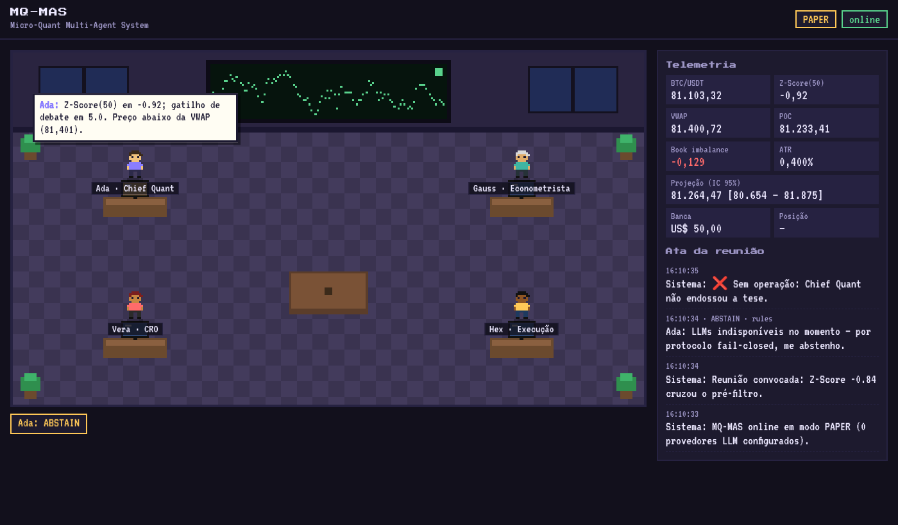

# MQ-MAS — Micro-Quant Multi-Agent System

Mesa quantitativa autônoma para **BTC/USDT Spot**, com banca inicial de **US$ 50**. São quatro agentes LLM que debatem cada operação dentro de um **escritório virtual em pixel art**, alimentado em tempo real por WebSocket.

> ⚠️ **Aviso honesto de risco.** Nenhum sistema elimina risco de mercado. O desenho elimina **risco de liquidação** (só spot, sem margem, sem futuros) e **limita a perda por trade** a 0,6% da banca. Ainda assim, cada trade pode perder até esse limite, e o sistema pode perder dinheiro de forma consistente. O modo padrão é `paper`. Rode semanas em paper antes de cogitar `live`.



---

## 1. Princípio de arquitetura: LLMs só podem **vetar**

O ponto mais importante do projeto: **nenhuma decisão de risco depende de um LLM.**

```
            ┌──────────── Python determinístico (fonte da verdade) ─────────────┐
 Binance ──►│ Z-Score · VWAP · POC · Book Imbalance · Regressão IC95 · ATR      │
 (ccxt)     │ Estudo de eventos (backtest) + memória SQLite → p̂ Beta-Binomial   │
            │ Kelly fracionário ∧ teto 0,6% · 20 travas rígidas (RiskManager)   │
            └────────────────────────────┬──────────────────────────────────────┘
                                         │ fatos numéricos
            ┌────────────────────────────▼──────────────────────────────────────┐
            │ Ada (Chief Quant, Tree of Thoughts) → Gauss (Econometrista)        │
            │ → Vera (CRO, Pre-Mortem) → Hex (Execução, slippage)                │
            │ Cada agente: APPROVE / REJECT / ABSTAIN. Primeiro veto encerra.    │
            └────────────────────────────┬──────────────────────────────────────┘
                     unanimidade ∧ todas as travas OK
                                         ▼
                  Ordem LIMIT spot → stop-limit nativo na corretora
```

* Um agente só vota APPROVE se o LLM aprovar **e** as checagens em código dele também passarem (por exemplo: o Econometrista exige p̂ ≥ 75% calculado em Python; o CRO exige que as 20 travas passem).
* Se todos os LLMs caírem, os agentes votam **ABSTAIN** e nada é operado (fail-closed).
* Os limites de risco são validados no boot: um `.env` que tente afrouxar o mandato (risco > 0,6%, stop > 0,6%) **impede o servidor de subir**.

## 2. Estrutura do projeto

```
mq-mas/
├── Dockerfile                  # multi-stage, usuário não-root, healthcheck
├── railway.toml                # 1 réplica, healthcheck, restart policy
├── requirements.txt / -dev.txt
├── .env.example
├── docs/DEPLOY_RAILWAY.md      # guia passo a passo
├── mqmas/
│   ├── main.py                 # FastAPI: lifespan, REST, /ws, estáticos
│   ├── config.py               # pydantic-settings + validação do mandato
│   ├── models.py               # modelos Pydantic de domínio e de eventos WS
│   ├── logging_setup.py        # logs JSON
│   ├── data/market_feed.py     # ccxt.pro WS (book) + REST (candles) + feed sintético
│   ├── quant/
│   │   ├── indicators.py       # Z-Score, VWAP de sessão ± σ, Volume Profile (POC/VA), ATR
│   │   ├── orderbook.py        # imbalance top-5, depth delta, microprice, slippage
│   │   ├── forecast.py         # regressão polinomial OLS (AICc) + intervalo de predição 95%
│   │   ├── sizing.py           # Kelly fracionário ∧ fixed-fractional, Sharpe por trade
│   │   ├── evidence.py         # estudo de eventos walk-forward + posterior Beta-Binomial
│   │   └── pipeline.py         # monta o QuantSnapshot (em thread)
│   ├── llm/
│   │   ├── router.py           # Groq → Gemini → OpenRouter, retries, circuit breaker
│   │   └── prompts.py          # ToT, Pre-Mortem, etc. (pt-BR)
│   ├── agents/
│   │   ├── base.py, personas.py
│   │   ├── chief_quant.py      # Tree of Thoughts (3 cenários com probabilidade)
│   │   ├── econometrician.py   # memória SQLite + p̂, Sharpe, Kelly
│   │   ├── cro.py              # travas rígidas + análise Pre-Mortem
│   │   ├── execution.py        # slippage ≤ 0,05%, preço limite
│   │   └── orchestrator.py     # loop de decisão e protocolo de debate
│   ├── risk/constraints.py     # RiskManager: 20 gates, circuit breaker, kill switch
│   ├── execution/
│   │   ├── broker.py           # PaperBroker / LiveBroker (ccxt spot)
│   │   └── position_manager.py # abertura, stop/TP, reconciliação no boot
│   ├── persistence/db.py       # SQLite WAL (aiosqlite)
│   ├── ws/hub.py               # broadcast com fila por cliente + replay
│   └── web/static/             # escritório pixel art (canvas + balões DOM)
└── tests/                      # 21 testes (quant, risco, router, debate ponta a ponta)
```

## 3. A matemática (e por que a meta de 75% existe)

| Métrica | Implementação |
|---|---|
| **Z-Score(50)** | `(P − μ₅₀)/σ₅₀`, σ amostral (ddof=1). Entrada exige `z ≤ −2`. |
| **VWAP dinâmico** | Ancorado por dia UTC, preço típico, bandas de ±2σ ponderadas por volume. |
| **Volume Profile** | O volume de cada candle é distribuído no intervalo [low, high]; o POC e a Value Area de 70% crescem a partir do POC. |
| **Order Book** | Imbalance `(Vb−Va)/(Vb+Va)` nos 5 primeiros níveis, razão bid/ask, depth delta (Δ do imbalance) e microprice de Stoikov. |
| **Regressão** | OLS de grau 1 ou 2, escolhido por AICc, nos últimos 48 candles de 15m. Intervalo de **predição** de 95% via t de Student: `ŷ ± t·s·√(1+x₀ᵀ(XᵀX)⁻¹x₀)`. |
| **Stop** | `clamp(1,5·ATR%, 0,3%, 0,6%)`, nunca acima de 0,6%. |
| **Take Profit** | Distância até a VWAP, limitada a [0,6%, 0,8%]. |
| **Sizing** | `risco = min(¼·Kelly, 0,6%) × banca`; `notional = risco / (stop + 2·fee + slippage)` ≤ caixa. |

**Os custos mudam o jogo.** Com a taxa padrão da Binance (0,1% por lado):

* uma perda no stop custa `0,6% + 0,2% + 0,05% = 0,85%` do notional;
* um ganho no TP de 0,8% rende `0,8% − 0,2% = 0,6%` líquido.

Por isso o notional fica em **~US$ 35** (e não US$ 50), para a perda máxima caber em US$ 0,30. O payoff fica em ~0,7:1, e o break-even exige **~59% de acerto** (68% com TP de 0,6%). A meta de 75% do mandato é coerente, mas é exigente: espere que o sistema **passe a maior parte do tempo sem operar**. Esse comportamento é intencional.

**Evidência estatística.** O p̂ é a média posterior de uma Beta(1+vitórias, 1+derrotas). Ela combina:

1. um estudo de eventos walk-forward sobre ~41 dias de candles, com as mesmas regras de stop/TP e premissa pessimista (se stop e alvo caem no mesmo candle, conta o stop);
2. os trades realizados no SQLite (paper e live).

São exigidos n ≥ 20, p̂ ≥ 75%, Sharpe por trade ≥ 0,2 e Kelly > 0.

## 4. Travas rígidas (CRO em código)

`spot_only` · `kill_switch` · `circuit_breaker` (2 stops seguidos no dia UTC → bloqueio de 24h; perda diária ≥ 1,5% → bloqueio até o fim do dia) · `single_position` · `fresh_data` · `zscore_oversold` · `below_vwap` · `structural_support` (Value Area) · `orderbook_pressure` · `spread` · `forecast_supports` · `sample_size` · `win_rate` · `trade_sharpe` · `kelly_positive` · `stop_bounds` · `tp_bounds` · `max_risk` · `min_notional` · `no_leverage`. Somam-se a elas a checagem de slippage ≤ 0,05% (Execução) e o preço limite ≤ mid·(1+0,05%).

**Proteção de queda mesmo se o processo cair:** após o fill, uma ordem **stop-limit nativa** fica pousada na corretora. O TP é gerido por software (contas spot não travam o mesmo BTC em duas ordens de venda sem OCO).

## 5. Roteador de LLMs

As cadeias são `Groq (llama-3.3-70b-versatile) → Gemini (gemini-2.5-flash) → OpenRouter (llama-3.3-70b:free)`. Todos usam endpoints compatíveis com OpenAI.

* retries com backoff exponencial e jitter em 429/5xx/timeout, respeitando `Retry-After`;
* circuit breaker por provedor (3 falhas → 120s fora, depois meio-aberto);
* saída validada por **Pydantic**: JSON inválido também cai para o próximo provedor.

**Economia de tokens.** O plano gratuito da Groq tem cota diária limitada de tokens. Por isso o debate completo só acontece quando `z ≤ −1,5` (pré-filtro) e respeita um cooldown de 15 minutos. Um veto encerra o debate sem gastar as chamadas seguintes. Fora disso, o escritório segue ativo com falas determinísticas montadas a partir dos números reais, mais um comentário LLM a cada 30 minutos.

> O enunciado citava Gemini 1.5 Flash e Mixtral. Os dois foram descontinuados pelos provedores, então os padrões são Gemini 2.5 Flash e Llama 3.3 70B. Tudo é configurável por variável de ambiente.

## 6. Protocolo WebSocket (`/ws`)

Todas as mensagens seguem o formato `{"type": ..., "ts": ISO-8601, "payload": {...}}`:

| type | payload |
|---|---|
| `hello` | `app, mode, symbol, agents[{role,name,title}]` |
| `telemetry` | `snapshot` (QuantSnapshot completo), `equity`, `mode`, `lock_until`, `llm`, `spark` |
| `agent_message` | `role, agent_name, text, vote, provider, debate_id, data` |
| `debate_start` | `debate_id, zscore, price` |
| `decision` | `debate_id, approved, reason, gates[], votes{}, sizing` |
| `position` | `event (opened/closed/entry_unfilled…), position` |
| `risk` | `event (circuit_breaker/kill_switch/…)` |

O escritório incluso (`/`) consome esse stream. Para outro escritório virtual (SoWork, WorkAdventure etc.), basta um bridge que assine `/ws` e mapeie `agent_message.role` para o avatar correspondente.

## 7. Rodando localmente

```bash
python3.12 -m venv .venv && . .venv/bin/activate
pip install -r requirements-dev.txt
cp .env.example .env          # preencha ao menos GROQ_API_KEY
pytest -q                     # 21 testes
uvicorn mqmas.main:app --reload --port 8000
# abra http://localhost:8000
```

Para uma demo offline, sem corretora: `MARKET_DATA_SOURCE=synthetic`.

**REST:** `GET /health`, `GET /api/state`, `GET /api/trades`, `GET /api/debates`, `POST /api/kill-switch?engage=true` (header `X-Admin-Token`).

## 8. Deploy

Veja **[docs/DEPLOY_RAILWAY.md](docs/DEPLOY_RAILWAY.md)**.

## 9. Limitações conhecidas

* **Partida a frio:** com pouco histórico, a trava `sample_size`/`win_rate` costuma bloquear. Rode em paper para acumular evidência fora da amostra.
* **Entrada órfã:** se o processo cair entre o envio da ordem de compra e o registro do fill, o registro `pending` é marcado como cancelado no boot e um evento `risk` é emitido. Nesse caso, confira a conta manualmente.
* **Stop nativo:** se a corretora rejeitar a stop-limit, o stop passa a ser monitorado por software (a cada 2s), o que só protege enquanto o processo está vivo.
* **Uma réplica:** mais de uma instância executaria dois loops de trading na mesma conta.
* O `pandas-ta` não é usado: os indicadores são implementados nativamente (e testados), porque o pacote ficou atrás do NumPy 2.

## Licença

MIT. Software fornecido "como está", sem garantia. Não é recomendação de investimento.
