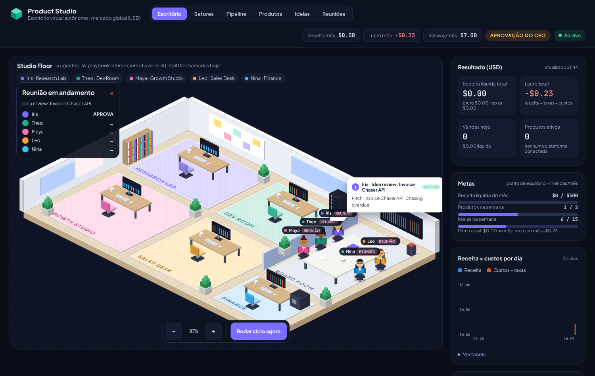

# Product Studio: escritório virtual autônomo

Escritório de cinco agentes de IA que pesquisam dores de solopreneurs no mercado global, votam ideias em reunião, constroem produtos (workflows n8n e microsserviços FastAPI), escrevem o marketing em inglês, publicam no Stripe, no Gumroad e no Whop, e entregam o download ao comprador. Você acompanha tudo como CEO num escritório isométrico ao vivo, com receita, custos (incluindo a Railway) e lucro em dólar.



> **O que já está pronto e o que fica com os agentes.** Este diretório é a empresa montada: o escritório, os cinco agentes, as integrações, o banco, o painel e o deploy. **Nenhum produto vem pronto.** Quem cria os produtos é o Theo, o engenheiro, a partir das ideias que a Iris aprova em reunião, assim que o escritório liga.

---

## 1. A equipe e os frameworks de cada um

Os votos e os números saem de código determinístico (`app/agents/frameworks.py`, com testes em `tests/test_frameworks.py`). A IA só escreve as falas e os textos, seguindo o prompt de especialista de cada agente (`app/agents/base.py`).

### Iris, Head of Product (Research Lab)
| Framework | Como é calculado |
|---|---|
| **Opportunity Score** (Dan Olsen) | `Importância + max(Importância − Satisfação atual, 0)`, de 0 a 20, por post e por tema |
| **Hair on Fire** | 🔥 quando o post fala em perda de dinheiro (ex.: "$500/month"), ≥ 5 h/semana de tempo perdido ou risco de perder clientes. "Seria legal…" é **nice-to-have** e quase não pontua |
| **Gambiarras = WTP** | Conta os passos manuais descritos ("baixo a planilha, subo no Sheets, rodo um script, mando e-mail…"); mais passos, maior o WTP (0 a 10) |
| **Time-to-Value** | Setup do comprador ≤ 5 min. Acima disso o score do MVP cai pela metade (ou para 20%) e a ideia é descartada |
| **Distribuição com CAC zero** | Buscas em inglês com intenção de compra + carona em ecossistemas grandes (n8n, Make, Stripe, Airtable, Supabase, OpenAI…) |
| **Preço pelo valor** | Horas economizadas × US$ 50–150/h; o preço é ~15% de **um mês** do valor mínimo, arredondado para terminar em 7/9 (ex.: 4 h/mês → US$ 200 de valor → **US$ 29**) |
| **Moat** | ≥ 2 sistemas integrados; "gerador de posts com ChatGPT" é marcado como **commodity** e descartado |

A Iris descarta antes da reunião, com o motivo registrado, tudo o que é nice-to-have, tem TTV > 5 min, moat < 2, é commodity ou tem score de MVP < 45.

### Theo, Senior Dev, QA & Architect (Dev Room)
- **Workflows n8n:** nó *Guard* logo após o webhook, com autenticação por `WEBHOOK_SECRET`, validação dos campos obrigatórios e **idempotência** (entregas duplicadas são ignoradas via `$getWorkflowStaticData`). Retry com backoff (3 tentativas) em toda chamada externa, timeout no HTTP e webhook respondido no recebimento.
- **Serviços FastAPI:** autenticação obrigatória, limite de 64 KB, validação de JSON, idempotência (`Idempotency-Key` ou id do payload), rate limit por cliente, erros que não vazam detalhes internos, e testes da API dentro do pacote.
- **OWASP:** bloqueio de `eval`/`exec`/`subprocess`, scanner de segredos hard-coded (chaves Stripe, Slack, AWS, Google, GitHub, Groq…) no código e no JSON.
- **QA de TTV:** o README tem no máximo 5 passos e o pacote no máximo 5 variáveis. Se não cumprir, o produto não vai à venda.

### Maya, Growth & Copy (Growth Studio)
- Landing page com **PAS** (Problema, Agitação, Solução) sobre a dor medida pela Iris.
- **Âncora de valor** só com números reais (ex.: "~6 h/mês = US$ 300–900 do seu tempo; um dev cobraria ~US$ 1.200; aqui custa US$ 47, uma vez").
- **Objeções sempre respondidas** no FAQ: precisa programar?, quanto tempo leva?, funciona no meu plano do n8n?, e se não funcionar?
- 4 e-mails pensados para evitar reembolso (dias 0, 1, 3 e 7), mais posts nativos para X, LinkedIn e Reddit.
- **Filtro de honestidade:** copy com depoimento inventado, "trusted by 2,000+", estrelas ou garantia é descartada e trocada pela versão determinística.

### Leo, Account Executive & RevOps (Sales Desk)
- Preços de US$ 19 a 149 terminados em 7 ou 9. Só aprova se um mês de valor for ≥ 3× o preço ("no-brainer").
- Descrição formatada por plataforma: Stripe com texto curto, Whop com bullets, Gumroad com HTML.
- Webhook assinado (HMAC), entrega do download na hora e registro idempotente.
- **Checkout abandonado** (`checkout.session.expired`): um único e-mail de recuperação, **somente** se o comprador aceitou receber comunicações no checkout (o Payment Link pede consentimento). **Pagamento recusado** gera alerta para você.

### Nina, CFO & Strategy (Finance)
- `Lucro líquido = receita bruta − taxas de checkout − infraestrutura (Railway + IA)`, fechado todo dia.
- **Veto:** a ideia precisa cobrir sua fatia do custo do escritório (payback ≥ 1) com margem de contribuição ≥ 70% depois das taxas.
- **Foco semanal:** os temas com maior margem real nos últimos 30 dias vêm primeiro, depois a evidência da Iris. Temas que a Iris descartaria só entram no foco se já dão dinheiro.
- **Auditoria do portfólio:** produto publicado há 21 dias sem venda é reposicionado (a Maya reescreve com outro ângulo, uma vez); depois de 42 dias, a Nina recomenda desativar (ou desativa sozinha, com `AUTOPAUSE_STALE=true`).

**Regra das reuniões:** aprovação exige 4 de 5 votos **e** o voto da Nina. Cada reunião custa uma única chamada de IA.

## 2. O ciclo (a cada `PIPELINE_INTERVAL_MIN`)

```
fechamento do dia (custos Railway acumulados por dia)
  → pesquisa (a cada RESEARCH_INTERVAL_MIN) → ideias
  → reunião semanal de metas (a cada 7 dias)
  → reunião de revisão de ideia (aprova / rejeita)
  → Theo constrói + QA → Maya escreve o kit → produto "pronto"
  → AUTOPUBLISH=true: Leo publica · false: aguarda 1 clique seu ("Aprovar e publicar")
  → venda (webhook) → registro idempotente → link de download por e-mail → alerta no Telegram/Discord
```

**Travas de qualidade antes de vender:**
- **n8n:** o JSON é montado a partir de modelos de nó com `typeVersion` reais. A IA só escolhe os passos. O QA confere gatilho, nomes únicos, conexões e chaves balanceadas no código, e documenta todas as variáveis `$env`.
- **Python:** o código é analisado sem ser executado. Exige `process(payload)` e bloqueia `subprocess`, `eval`, `exec`, `os.system` e afins. Se o código da IA reprovar, entra o código do playbook.

## 3. Custo zero de IA

As IAs são todas de plano gratuito, em cascata: **Groq → Gemini → OpenRouter (modelos `:free`) → playbook interno**. O playbook (`app/agents/playbook.py`) traz 12 dores recorrentes com produto, preço, passos de workflow e código prontos. **Sem nenhuma chave, o escritório funciona do mesmo jeito** (com textos mais genéricos). `LLM_DAILY_CALL_BUDGET` limita as chamadas por dia para não estourar os planos gratuitos.

As fontes de pesquisa também são gratuitas. O X/Twitter (API paga) e o Google Trends (não tem API oficial) ficaram de fora de propósito.

## 4. Painel executivo (API)

| Endpoint | Retorno |
|---|---|
| `GET /api/dashboard/summary` | Receita, taxas, custos e lucro (total, mês e hoje), metas, custos fixos, plataformas, status das IAs, estado de cada agente |
| `GET /api/dashboard/sales/daily?days=30` | Vendas, receita, custos e lucro por dia |
| `GET /api/products` · `/api/products/{id}` | Produtos ativos, anúncios, vendas e kit de marketing |
| `GET /api/ideas` · `/api/signals` | Ideias com evidências (links para os posts originais) |
| `GET /api/meetings` · `/api/activity` | Atas com votos; atividade por agente |
| `GET /api/sectors` | Um painel por setor |
| `POST /api/products/{id}/approve` · `POST /api/run/{tick\|research}` | Ações do CEO (header `X-Admin-Token`) |
| `POST /webhooks/stripe` · `/webhooks/gumroad?key=` · `/webhooks/whop` | Vendas (assinatura verificada) |
| `GET /p/{slug}` · `GET /d/{token}` | Landing page do produto · download do comprador (expira) |
| `WS /ws` | Eventos ao vivo do escritório |

## 5. Plataformas de venda: o que é automático

| Plataforma | Publicação | Vendas |
|---|---|---|
| **Stripe** (recomendado) | 100% automática: Product → Price → Payment Link | Webhook `checkout.session.completed`, `charge.refunded`, `checkout.session.expired` e `payment_intent.payment_failed` |
| **Whop** | Automática via API v1 (`/products` + `/plans` one_time). Confira os campos na doc do Whop: não consegui acessá-la deste ambiente | Webhook `payment.succeeded` (HMAC) |
| **Gumroad** | Tenta `POST /v2/products`. Esse endpoint não aparece em todas as versões da doc, então, se falhar, o anúncio vira "manual" e o Leo deixa título, descrição, preço e `.zip` prontos para você subir | Ping de venda em `/webhooks/gumroad?key=…` |

A taxa do Stripe é estimada (2,9% + US$ 0,30, configurável). O painel marca esse valor como estimado.

## 6. Rodar localmente

```bash
cd studio
python -m venv .venv && . .venv/bin/activate
pip install -r requirements-dev.txt
cp .env.example .env            # tudo opcional
uvicorn app.main:app --reload    # http://localhost:8000
pytest -q && ruff check app tests
```

Stack completa (Postgres + Redis + n8n): `docker compose up --build` (escritório em :8000, n8n em :5678).

## 7. Deploy na Railway (econômico)

1. **New Project → Deploy from GitHub repo** → este repositório. No serviço, em **Settings → Root Directory**, coloque `studio`. O `studio/railway.json` cuida do resto (Dockerfile, healthcheck `/health`, 1 réplica).
2. **+ New → Database → PostgreSQL.** No serviço do escritório, crie a variável `DATABASE_URL=${{Postgres.DATABASE_URL}}`.
3. **Volume:** monte um volume em `/data`, onde ficam os `.zip` dos produtos.
4. **Variables:** `ADMIN_TOKEN`, `PUBLIC_BASE_URL` (o domínio gerado pela Railway) e as chaves gratuitas de IA que quiser (Groq/Gemini/OpenRouter). Para vender: `STRIPE_SECRET_KEY` + `STRIPE_WEBHOOK_SECRET`, com o webhook apontando para `https://<domínio>/webhooks/stripe`. Para entregar: `RESEND_API_KEY`. Para os alertas: Telegram ou Discord.
5. **Settings → Networking → Generate Domain.** Abra o domínio: é o escritório.

**Custo mensal estimado:** web ~US$ 5 + Postgres ~US$ 1 a 3. Redis e n8n são **opcionais**: o escritório usa uma fila em memória e entrega os workflows como arquivo, então não precisa de n8n próprio. Se você adicionar esses serviços, informe os valores em `RAILWAY_REDIS_USD` e `RAILWAY_N8N_USD` para o P&L contar. Os valores `RAILWAY_*_USD` são estimativas que entram no custo diário. Confira o consumo real em **Railway → Usage** e ajuste.

**Escalar com Redis (opcional):** com `REDIS_URL` definido, rode um segundo serviço com o comando `python -m app.worker` e coloque `AGENTS_IN_WEB=false` no serviço web. Os agentes passam a rodar no worker, e o web só serve o escritório e retransmite os eventos.

## 8. Estrutura

```
studio/
├── Dockerfile · railway.json · docker-compose.yml · .env.example
├── app/
│   ├── main.py            # FastAPI: escritório, API, webhooks, WebSocket, loop dos agentes
│   ├── worker.py          # worker separado (Redis) ou --once (cron)
│   ├── config.py · db.py
│   ├── models/            # SQLAlchemy: sinais, ideias, produtos, kits, anúncios, vendas, custos, reuniões
│   ├── agents/            # personas (prompts), frameworks (votos), playbook, Iris, Theo, Maya, Leo, Nina, office
│   ├── integrations/      # pesquisa (Reddit/HN/PH), pagamentos (Stripe/Gumroad/Whop), notificações (Telegram/Discord/Resend)
│   ├── llm/router.py      # cascata de IAs gratuitas com validação JSON e fallback
│   ├── services/          # finanças (P&L), n8n (builder + QA), empacotamento, fila/agendador, eventos
│   ├── api/               # painel executivo + páginas públicas
│   └── web/static/        # escritório isométrico (motor CSS compartilhado com o MQ-MAS)
└── tests/
```

## 9. Limites honestos

- **Autonomia de publicação:** `AUTOPUBLISH=false` por padrão. Revise os primeiros produtos antes de ligar: vender algo gerado por IA sem olhar arrisca reembolsos e reclamações nas plataformas.
- **O modelo de demanda da Nina é uma estimativa arbitrária** (0,1 + score do MVP ÷ 40 vendas/mês, ×1,5 se for hair on fire) até existirem vendas reais. A partir daí, quem manda são a margem real e as vendas por tema.
- **Os detectores da Iris leem texto em inglês** (valores em $, "hours a week", "losing clients"…). Posts em outros idiomas pontuam pouco.
- **Reddit a partir da nuvem** costuma bloquear sem OAuth. Crie um app "script" gratuito e preencha `REDDIT_CLIENT_ID` e `REDDIT_CLIENT_SECRET`.
- **Esquema do banco:** no boot, o escritório cria as tabelas e **adiciona colunas novas** a bancos existentes. Renomear, trocar tipo ou remover coluna ainda precisa de migração (Alembic).
- **Os workflows n8n** usam `$env`. No n8n self-hosted isso exige `N8N_BLOCK_ENV_ACCESS_IN_NODE=false` (o README de cada produto explica).
